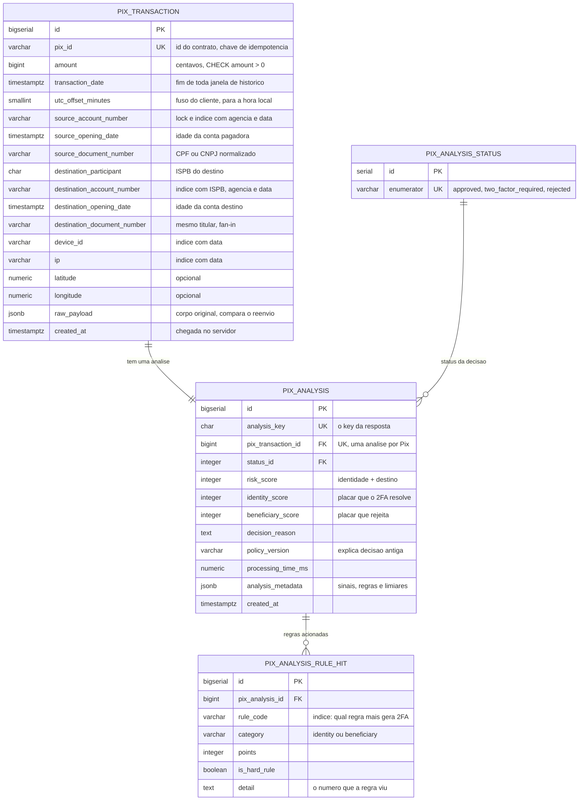
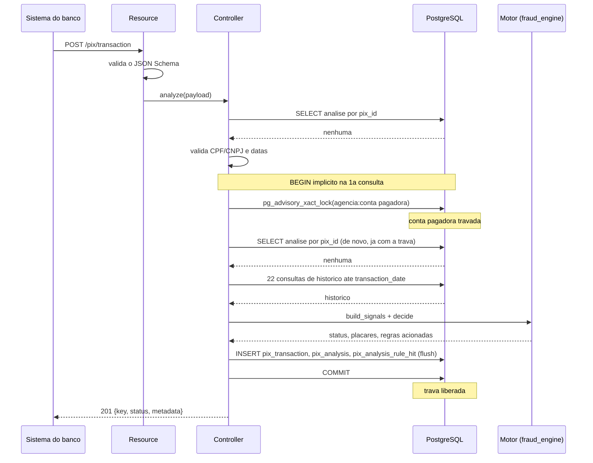
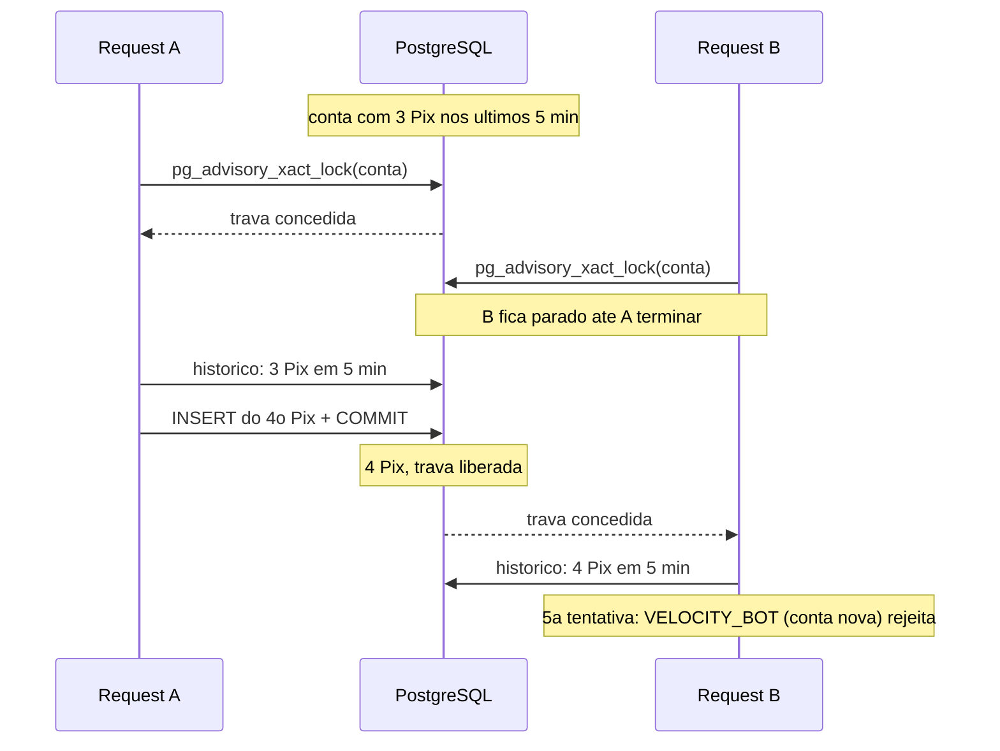

# RFC — Motor antifraude de Pix: aprovar, pedir 2FA ou rejeitar antes do dinheiro sair

| | |
|---|---|
| **Time** | Grupo 3 · Victor Kazunori · Matheus Reis |
| **Data** | 17/10/2026 |
| **Versão** | 1 (política `2026.10.18-v11`) |

## Contextualização

### Entendendo o problema

O serviço recebe um pedido de Pix antes de ele ser enviado ao SPI e responde, em milissegundos, uma de três decisões: `approved`, `two_factor_required` ou `rejected`. Também devolve a análise gravada quando consultado. Quem chama são outros sistemas do banco, identificados por um token interno; o cliente final nunca fala com o motor.

Como o Pix é liquidado na hora e é irrevogável, a decisão precisa sair antes do dinheiro, sem analista no meio. O serviço precisa sustentar cinco garantias:

- **Decisão certa para o tipo de golpe:** o 2FA prova que é o dono da conta quem paga. Isso resolve a tomada de conta, mas não o golpe de engenharia social nem a coação, em que quem paga é a própria vítima, que passa no 2FA. Se falhar, o motor pede 2FA para um golpe que o 2FA não para, e o dinheiro sai.
- **Sem travar o cliente bom:** aluguel, racha do bar, transferência entre contas próprias e primeiro Pix de valor comum passam sem fricção. Se falhar, a fricção vira prejuízo e reclamação.
- **Decisão explicável e reconstruível:** cada análise grava as regras acionadas, os sinais que as acionaram e a versão da política. Se falhar, não há como responder a uma contestação do MED.
- **Um Pix, uma análise:** o mesmo `id` reenviado devolve a mesma decisão, sem reavaliar; o mesmo `id` com outro conteúdo é recusado. Se falhar, o reenvio conta duas vezes no histórico, ou um `id` aprovado "aprova" outro valor.
- **Histórico consistente sob concorrência:** dois Pix simultâneos da mesma conta não podem ler o mesmo histórico. Se falhar, uma rajada de Pix passa inteira pela regra de velocidade.

Fora do escopo desta entrega: onboarding e cadastro de contas, front-end, outras APIs (como a consulta de CNPJ no Serpro), a confirmação do resultado do 2FA, a atestação do aparelho e o ajuste de limite noturno pedido pelo cliente (o aumento vale só depois de no mínimo 24 h, e esse dado não vem no payload; o motor usa o teto padrão).

### Explicando a solução de forma macro

O resource valida o formato (JSON Schema). O controller valida o conteúdo (CPF/CNPJ, datas), trata a idempotência, trava a conta pagadora e busca o histórico pelo repository: 22 consultas, todas recortadas "até a data deste Pix". Com esse retrato, o motor (Python puro, em `controllers/fraud_engine/`, sem banco nem HTTP) monta os sinais e roda 30 regras, de quatro tipos:

- **Duras (7):** rejeitam sozinhas. Uma delas bloqueia, por 30 dias, a conta pega repassando dinheiro de golpe.
- **De identidade:** somam no placar de identidade, que pede 2FA.
- **De destino:** somam no placar de destino, que rejeita, porque o 2FA não ajuda.
- **Bônus de confiança:** descontam só da própria categoria.

A política lê uma tabela de decisão fixa: regra dura, depois destino ≥ 60, depois total ≥ 90 (todas rejeitam), e por fim total ≥ 40 (pede 2FA). O controller grava o Pix, a análise e uma linha por regra acionada, na mesma transação. Os números da política ficam num único arquivo, cada um com o porquê, e foram calibrados com uma simulação de 150 clientes, 5 empresas e 14 tipos de fraude.

Alternativas descartadas:

- **Placar único de risco** — descartado porque um bônus de confiança no pagador ("aparelho de sempre") compensaria o risco do destino, e o golpe do falso parente sai exatamente do aparelho de sempre. Ganharia se o 2FA protegesse também contra o golpe autorizado.
- **Modelo de machine learning** — descartado porque não há fraude rotulada; um modelo seria peso inventado com aparência de rigor, e mais difícil de explicar a cada decisão. Ganharia com fraude confirmada em produção e o resultado dos desafios 2FA. A tabela `pix_analysis_rule_hit` já guarda o histórico de que ele precisaria.
- **Lista negra permanente de destinos** — descartada porque se alimenta sozinha: a conta marcada passa a ter tudo rejeitado e nunca sai. Usamos pontuação com janela de 30 dias, contando pagadores distintos. Ganharia com uma lista de fraude confirmada (analista ou marcação do BC no DICT).
- **Consulta de CNPJ no Serpro no caminho do Pix** — descartada porque acrescenta latência e um ponto de falha a cada Pix, e "outras APIs" estão fora do escopo. Ganharia como enriquecimento assíncrono, que marca o recebedor para os próximos Pix.
- **Janelas pelo horário de chegada (`created_at`)** — descartado porque quem chama é o sistema do banco, que carimba a data, e porque julgar pela data do Pix torna cada decisão reprodutível. Ganharia se a origem da data não fosse confiável.

## Implementação

### Rotas

| Método | Caminho | O que faz | Entrada (campos que importam) | Saídas (status e quando) |
|---|---|---|---|---|
| `GET` | `/` | Diz qual serviço é este. Aberta, sem token | — | `200` |
| `GET` | `/health_check` | Diz se o serviço está de pé. Aberta, sem token | — | `204` |
| `POST` | `/pix/transaction` | Analisa um Pix e grava a decisão. **Idempotente** por `UNIQUE(pix_id)`: o mesmo `id` com o mesmo conteúdo devolve a análise gravada, sem reavaliar; a comparação é com o `raw_payload` gravado | `id`, `amount` (centavos), `transaction_date` (com fuso), `source_account` e `destination_account` (agência, conta, abertura, documento; ISPB no destino), `source` (`device_id`, `channel`, `ip`, `geolocation` opcional) | `201` com `key`, `status` e `metadata`; `200` reenvio do mesmo Pix (corpo idêntico); `400 QIT000001` fora do schema; `409 QIT002006` mesmo `id` com outro conteúdo; `422 QIT002002` CPF/CNPJ com dígito verificador errado; `422 QIT002003` data que não existe; `422 QIT002004` conta aberta depois do Pix; `422 QIT002005` data mais de 2 min no futuro |
| `GET` | `/pix/transaction/{id}` | Devolve a análise gravada, com o mesmo corpo do `POST` | `id` no caminho | `200`; `404 QIT002001` Pix nunca analisado |

Todas as rotas, menos `/` e `/health_check`, exigem o cabeçalho `INTERNAL-TOKEN`; sem ele ou com valor errado, `403 QIT000002`. Valores em centavos (`BIGINT`), como manda o contrato. O CNPJ alfanumérico (Receita, julho de 2026) é aceito.

### Banco de Dados (Somente diagrama)

### Fluxos

**Analisar um Pix — caminho feliz**

1. O resource valida o formato contra o JSON Schema. Fora do formato, `400 QIT000001`, antes de qualquer consulta.
2. O controller procura uma análise com o mesmo `pix_id`. Não há.
3. Valida o que o schema não sabe validar: dígito verificador do CPF/CNPJ, data que existe, conta aberta antes do Pix, data no máximo 2 min no futuro. Qualquer falha sai com `422` e nada é gravado: entrada inválida não é decisão antifraude.
4. Trava a conta pagadora com `pg_advisory_xact_lock`, que dura até o fim da transação. Outra análise da mesma conta espera aqui.
5. Procura o `pix_id` de novo, já com a trava: um reenvio que esperou a trava encontra aqui a análise do primeiro.
6. Busca o histórico (pagador, destino, par pagador→destino, aparelho, IP, cadeia de laranjas, soma da noite), sempre até o `transaction_date`. Um Pix nunca é julgado com informação que só existiu depois dele.
7. O motor monta os sinais, roda as 30 regras e lê a tabela de decisão.
8. O controller grava o Pix, a análise e uma linha por regra acionada, confirma (o que solta a trava) e responde `201`.

**Analisar um Pix — falha: o mesmo `id` de novo**

1. **Mesmo conteúdo** (retry de rede, clique duplo): no passo 2 a análise existe e o `raw_payload` gravado é igual ao payload novo. Responde `200` com o corpo idêntico ao da primeira vez. Nada é reavaliado nem gravado: reavaliar daria outra decisão, porque o primeiro Pix já conta na velocidade.
2. **Outro conteúdo**, no mesmo `id`: responde `409 QIT002006`. Sem isso, bastaria reaproveitar o `id` de um Pix aprovado para "aprovar" outro valor ou outro destino.
3. **Mesmo `id` ao mesmo tempo, por contas pagadoras diferentes:**
   - a trava é por conta, então os dois requests não se esperam e passam pelo passo 5;
   - quem barra o segundo é o `UNIQUE(pix_id)`, no `flush` do passo 8;
   - o controller desfaz a transação inteira, relê a análise que ficou e responde `200` (mesmo conteúdo) ou `409` (outro conteúdo), em vez de erro 500.

**Analisar um Pix — falha: dois Pix simultâneos da mesma conta**

1. A e B chegam juntos da mesma conta. A pega a trava; B espera no banco.
2. A lê o histórico, decide, grava e confirma. A trava é liberada.
3. B recebe a trava e lê um histórico que **já inclui** o Pix de A. Sem a trava, os dois leriam o mesmo histórico, e uma rajada simultânea passaria inteira pela regra de velocidade.
4. Contas diferentes não se esperam: a trava é por conta pagadora, e o resto do tráfego segue em paralelo.

**Consultar uma análise — caminho feliz e falha**

1. `GET /pix/transaction/{id}` procura a análise pelo `pix_id` e devolve exatamente o corpo do `POST`, montado a partir do que foi gravado.
2. Se o `id` nunca foi analisado (inclusive quando o `POST` saiu com `400` ou `422`, que não gravam nada), responde `404 QIT002001`.

> ## Principal desafio
>
> - **Qual é:** decidir, para cada Pix, entre pedir 2FA e rejeitar, sem travar o cliente bom e sem deixar passar o golpe em que o 2FA não ajuda.
> - **Por que é difícil:** a solução óbvia (somar sinais de risco num placar só e pedir 2FA quando ele sobe) falha nos dois sentidos:
>   - **Golpe passa:** no golpe de engenharia social e na coação, quem paga é a própria vítima, no aparelho de sempre. Os sinais de confiança no pagador descontam pontos, o 2FA aparece, a vítima confirma e o dinheiro sai.
>   - **Cliente bom é barrado:** regras duras calibradas para o fraudador (5 Pix em 5 minutos, 3 pessoas num aparelho) barram o racha do bar e a família que divide o celular. E o "mesmo titular", que deveria ser o Pix mais seguro, vira a porta do golpe da conta-espelho, aberta no CPF da vítima.
> - **Como o desenho resolve:**
>   - **Dois placares separados:** identidade (2FA resolve) e destino (rejeita, porque o 2FA não resolve). Um bônus só desconta da própria categoria, então confiar no pagador nunca "paga" o risco do destino.
>   - **Tabela de decisão fixa:** regra dura, depois destino ≥ 60, depois total ≥ 90, que rejeitam; depois total ≥ 40, que pede 2FA.
>   - **Régua por maturidade:** as regras duras olham quem paga. Conta nova é barrada no 5º Pix em 5 minutos e com 3 pagadores no aparelho; conta com 180 dias e histórico aprovado pede 2FA e só é barrada em volumes que nenhum uso humano explica.
>   - **Conta própria comprovada:** o mesmo CPF só vale como transferência entre contas próprias se a conta de destino é antiga ou já conhecida.
>   - **Teto diário que pede 2FA:** passar do teto de 24 h pede 2FA e nunca rejeita sozinho, porque esvaziar a conta com o celular destravado é tomada de conta, que o 2FA segura. O teto acompanha o histórico: 3x o maior dia dos últimos 90 dias (pessoa física com perfil), ou R$ 20 mil sem perfil.
>   - **Teto noturno com saída:** acima de R$ 5.000 à noite o Pix é rejeitado, mesmo no aparelho de sempre, porque sob coação a vítima passa no 2FA. O cliente que precisa de um Pix maior ajusta o limite antes, e pelo Regulamento do Pix o aumento só vale depois de no mínimo 24 h, prazo que o sequestrador não tem. Esse ajuste é cadastral e não vem no payload, então fica como evolução: com ele no contrato, o teto passaria a ser o limite do cliente.
>   - **Laranja pego fica bloqueado:** o motor barra o repasse do laranja quando o dinheiro que entrou já parecia golpe. A partir daí a conta não envia (nem para outro laranja, outra central ou conta do mesmo CPF) e não recebe por 30 dias. Sem isso, a segunda tentativa abaixo da metade do valor recebido só pedia 2FA, que o dono do laranja passa.
>   - **Funil com piso de valor:** muitos pagadores para a mesma pessoa física só pesam a partir de R$ 200 por Pix. O golpe em massa tira centenas ou milhares de cada vítima; o vendedor ambulante recebe de dezenas de clientes em ticket baixo e não pode cair no 2FA a cada venda.
>   - **Calibragem medida:** cada número saiu da simulação. Com a semente 42: 89% dos clientes bons aprovados direto e nenhum rejeitado, com latência p99 de 39 ms.
